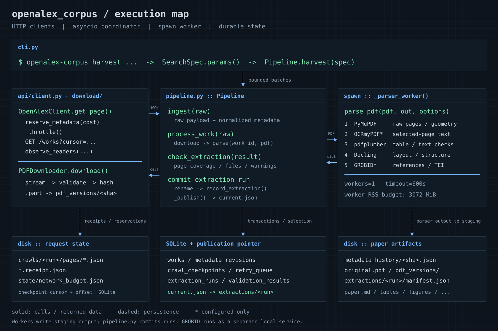

# OpenAlex Corpus Harvester

OpenAlex 메타데이터와 공개 논문 PDF를 보존하고, 여러 파서의 결과와 검증 근거를 함께 저장하는 Python CLI입니다. 실행 가능한 프로젝트는 [`openalex_corpus/`](openalex_corpus/)에 있습니다.



## 문서 안내

| 문서 | 내용 |
|---|---|
| [설치 및 CLI](openalex_corpus/README.md) | 설치, 설정, 수집, 재처리, 검증, 백업, 내보내기 |
| [원리와 아키텍처](openalex_corpus/docs/ARCHITECTURE.md) | 파이프라인·커서·예산·불변 저장·복구·품질 판단의 상세 그림 |
| [개발 및 검증 기록](openalex_corpus/docs/DEVELOPMENT_LOG.md) | 구현 선택, 실제 실행 결과, 수정 과정과 남은 한계 |
| [GROBID·OCR 실제 검증](openalex_corpus/docs/ENHANCED_VALIDATION.md) | 설치 버전, 실논문 TEI, 실제 OCR, PARTIAL 재처리 |
| [OPV 수집 범위와 현황](openalex_corpus/docs/OPV_SCOPE.md) | 검색식, 후보 수, 실제 저장 범위, 키·예산·재개 방법 |
| [요구사항별 테스트](openalex_corpus/docs/TEST_MATRIX.md) | 모의 실패 주입과 실제 엔진 검증의 구분 |

## 빠른 시작

```bash
git clone https://github.com/jongsu-king/openalex-corpus-harvester.git
cd openalex-corpus-harvester/openalex_corpus
uv sync --locked --python 3.11 --extra dev --extra docling --extra ocr
uv run openalex-corpus doctor
```

GROBID는 Java 21이 필요하고 OCR은 Tesseract·Ghostscript가 필요합니다. 서비스와 모델은 별도로 설치해야 하며 [설치 문서](openalex_corpus/README.md)를 따릅니다. GitHub에는 소스·설정 예시·테스트·문서·그림을 저장합니다. API 키, 로컬 모델, 원문 PDF, SQLite, 수집 JSON, 실행 로그는 포함하지 않습니다.

2026-10-29 검증에서 실제 논문 2편·14페이지를 처리했고, GROBID/OCR 연동을 확인했습니다. OPV 검색은 82,363개의 후보를 보고했으며 조사 원본 608건, 최종 검색 DB 100건을 보존한 상태입니다. 전체 문헌을 모두 확보했다는 뜻은 아닙니다. 날짜가 있는 기록과 [수집 범위](openalex_corpus/docs/OPV_SCOPE.md)를 함께 확인하세요.
