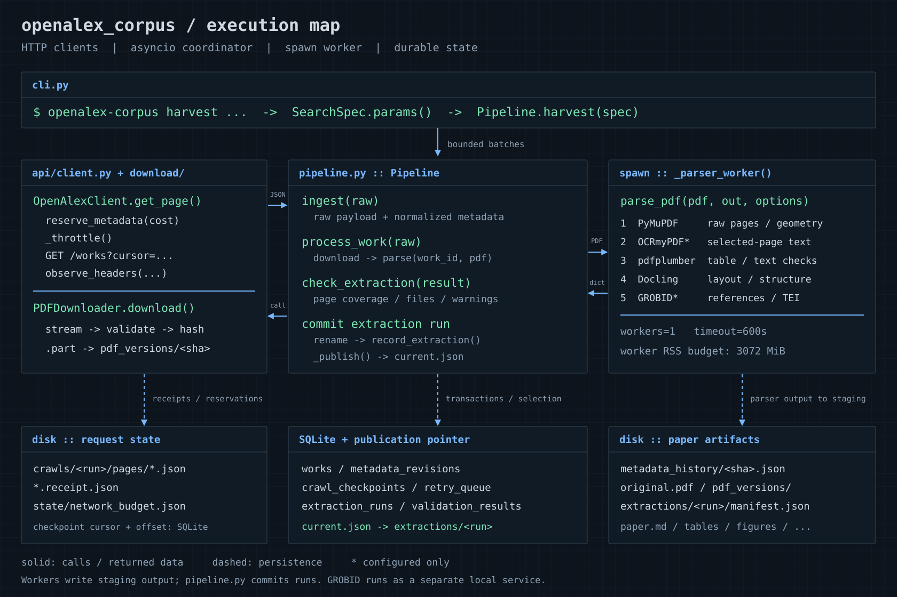

# OpenAlex Corpus Harvester

OpenAlex 원본 메타데이터와 공개 PDF를 누적 보존하고, 전체 페이지를 여러 파서로 추출하는 Python CLI입니다. Markdown, 페이지 좌표, 표, 그림, 수식 후보 영역, 참고문헌 원문, 검증 보고서와 SQLite를 저장합니다. 요약·LLM 해석·임베딩·웹 UI는 포함하지 않습니다.

**검증 환경:** Python 3.11.16 / macOS arm64. 기본 의존성과 Docling을 설치했으며 실제 OA 논문 2편, 14페이지를 처리했습니다. 설치 버전은 `requirements-tested.txt`, 의존성 잠금은 `uv.lock`에 있습니다. [검증 기록](docs/VALIDATION.md), [요구사항별 테스트](docs/TEST_MATRIX.md)를 함께 확인하세요.

**후속 작업:** GROBID 0.9.1과 OCRmyPDF/Tesseract를 설치하고 실제 연동 테스트 및 기존 `PARTIAL` 재처리를 수행했습니다. [후속 검증](docs/ENHANCED_VALIDATION.md), [OPV 검색·수집 현황](docs/OPV_SCOPE.md)을 확인하세요. OPV는 별도 `data/opv`에 누적합니다.



원리의 상세 설명과 흐름도는 [아키텍처](docs/ARCHITECTURE.md), 구현 선택과 실행 이력은 [개발 기록](docs/DEVELOPMENT_LOG.md)에 있습니다. 그림은 `python scripts/render_architecture.py`로 재생성할 수 있으며, 상세 Mermaid 도표는 GitHub에서 직접 표시됩니다.

## 설치

```bash
cd openalex_corpus
uv sync --locked --python 3.11 --extra dev --extra docling --extra ocr
source .venv/bin/activate
python scripts/prepare_models.py --output-dir data/models/docling
openalex-corpus doctor
```

처음 설치하는 macOS 환경에서는 `brew install openjdk@21 tesseract ghostscript`로 시스템 의존성을 준비합니다. 검증에 사용한 Mac에는 설치되어 있지만 새 clone에 포함되지는 않습니다. Linux 설치와 자세한 조건은 [GROBID 운영](docs/GROBID_SETUP.md), [OCR 설정](docs/OCR_SETUP.md)을 확인하세요. 기본 설정과 `config/enhanced.yaml`은 로컬 GROBID와 선택적 OCR을 사용합니다.

GROBID의 최초 설치·기동은 다음과 같습니다. 로그인 자동 실행에 등록하지 않으며, 이미 설치했다면 `start`로 재기동합니다.

```bash
.venv/bin/python scripts/grobid_service.py install
.venv/bin/python scripts/grobid_service.py start
.venv/bin/python scripts/grobid_service.py status
openalex-corpus --config config/enhanced.yaml reparse --status PARTIAL
# 작업이 끝나 서비스를 종료하려면:
.venv/bin/python scripts/grobid_service.py stop
```

모델 준비 명령은 필요한 Docling 레이아웃·표 모델을 내려받습니다. OpenAlex API 비용이 발생하지 않습니다. 검증 환경의 모델은 로컬 `data/`에 있으며 GitHub에 포함되지 않으므로 새 clone에서는 준비 명령을 실행해야 합니다. Docling을 설치할 수 없어도 메타데이터 수집과 PyMuPDF/pdfplumber 추출은 작동하며, 기본 구조 파서의 부재를 경고합니다. Linux에서도 같은 Python 명령을 사용합니다. 실제 설치 검증은 위 macOS 환경에서 수행했습니다.

일반 CLI는 API 키를 **환경변수에서** 읽습니다. OPV 전용 스크립트는 `--env-file .env`를 명시하면 파일의 키를 안전하게 읽어 환경변수에 전달합니다. `.env`를 자동 탐색하거나 셸 코드로 실행하지 않습니다.

```bash
export OPENALEX_API_KEY='YOUR_KEY'
openalex-corpus harvest \
  --query 'organic solar cells' \
  --from-year 2018 --to-year 2026 \
  --max-works 100 --download-pdf --parse-markdown
```

키 없이 단건 조회와 첫 검색 페이지를 시험할 수 있습니다. **두 번째 커서 페이지부터 무료 API 키가 필요합니다.** 키가 없거나 예산이 부족하면 `PAUSED`와 종료 코드 2를 반환하고 체크포인트를 유지합니다. 키 설정 후 같은 명령으로 재개합니다. API 키를 명령 인수·설정 YAML·Git에 넣지 마세요.

## CLI

전역 `--config/-c`, `--data-dir` 옵션은 **명령 앞**에 둡니다. 결과는 JSON이며 라이브러리 진행 메시지는 stderr에 나타날 수 있습니다.

```bash
openalex-corpus --config /absolute/path/config/config.yaml stats
openalex-corpus fetch --doi '10.48550/arxiv.2205.01833'
openalex-corpus fetch --openalex-id W4229010617 --download-pdf --parse-markdown

# 동일 URL에서 변경된 PDF를 명시적으로 확인: 원본과 모든 버전 보존
openalex-corpus fetch --openalex-id W4229010617 --download-pdf --refresh-pdf

openalex-corpus reparse --status PARTIAL --max-works 100
openalex-corpus reparse --openalex-id W4229010617
openalex-corpus reconcile
openalex-corpus retry --failed-only
openalex-corpus retry --failed-only --now --max-works 10
openalex-corpus verify --all
openalex-corpus stats

openalex-corpus export --format parquet
openalex-corpus export --format jsonl
openalex-corpus export --format json
openalex-corpus export --format csv
openalex-corpus export --format markdown --output data/exports/markdown-run-1
openalex-corpus export --format sqlite --output data/exports/corpus-copy.sqlite
openalex-corpus backup --output data/exports/backup.sqlite
```

`--parse-markdown`는 다운로드를 함께 수행합니다. `--max-works`는 **이번 실행에서 처리할 응답 레코드 수**이며 최대 10,000입니다. 같은 검색은 미완료 크롤을 재개하고, `--fresh`는 처음부터 재검색합니다. 페이지 중간에서 멈춰도 원본 응답과 내부 offset을 보존합니다. 중복 Work ID는 upsert하고 처리 횟수·고유 ID 수를 구분합니다. 정상 PDF는 체크섬 검사 후 재사용합니다.

`retry`는 최대 시도 수와 재시도 시각을 따릅니다. `--now`는 백오프 대기를 건너뛰는 명시적 요청이며 예산·최대 시도 제한은 유지됩니다. 일반 실행으로 복구된 작업도 큐에서 완료 처리됩니다. 파서·OCR·TEI 설정을 개선한 뒤 `reparse`하면 새 이력이 생성되고 이전의 더 좋은 정상 결과가 보호됩니다.

종료 코드: 0=명령 완료(논문이 `PARTIAL`/`PDF_UNAVAILABLE`일 수 있음), 1=설정·인수·실행 오류, 2=일시정지·실패 작업·무결성 실패, 130=사용자 중단. 배치에서는 JSON의 개별 상태도 확인하세요. `verify.valid`는 저장 무결성과 자동 누락 검사 결과이며 원문 의미의 완전한 복원을 뜻하지 않습니다.

## 검색

| 옵션 | 의미 |
|---|---|
| `--query` | 제목·초록·키워드·지원되는 fulltext 검색 |
| `--title`, `--abstract` | 제목·초록 범위 검색 |
| `--from-year`, `--to-year` | 출판 연도 범위 |
| `--from-date`, `--to-date` | 출판일 범위 `YYYY-MM-DD` |
| `--source`, `--author`, `--institution`, `--topic` | 공식 S/A/I/T ID |
| `--doi`, `--openalex-id` | 논문 식별자 |
| `--oa/--no-oa`, `--work-type`, `--min-citations` | OA·유형·최소 인용 수 |
| `--has-pdf/--no-has-pdf` | OpenAlex 보관 PDF 존재: `has_content.pdf` |
| `--has-content/--no-has-content` | 색인 fulltext 존재: `has_fulltext` |
| `--updated-since` | 계정 권한이 필요한 `from_updated_date` |
| `--filter field:value` | 등록된 공식 필터, 반복 지정 가능 |

`--has-pdf`가 false여도 외부 OA location에 PDF가 있을 수 있습니다. 기관·저자·학술지 이름을 ID로 전송하지 않습니다. 학술지 ISSN은 `--filter primary_location.source.issn:1234-5678`, PMID/PMCID는 `--filter ids.pmid:...` 등의 필터를 사용합니다. 알 수 없는 필터는 거부합니다. YAML의 `search`에도 동일한 필드명을 지정할 수 있습니다.

```yaml
search:
  query: organic solar cells
  from_year: 2018
  to_year: 2026
  oa: true
  filters:
    primary_location.source.type: journal
```

갱신일 필터 권한이 없는 계정은 출판일 범위로 `--fresh` 재탐색하고 기존 ID와 비교합니다. 이것이 오래된 논문의 모든 메타데이터 변경·삭제·OpenAlex 병합을 탐지하지는 않습니다. 중복 DOI는 후보로 기록하며 다른 ID·원고를 강제로 합치지 않습니다. 전체 데이터 수집에는 [공식 Snapshot](https://help.openalex.org/access/snapshot/)을 사용하세요.

## 비용과 자원

기본값은 메타데이터 1,000요청/UTC일, 로컬 예산 $0.05/UTC일, 동시 다운로드 3개, 실행당 다운로드 대상 100개, 파일당 100 MiB입니다. **OpenAlex 보관 콘텐츠는 기본 0회/$0로 비활성화**되어 있습니다. 보관 PDF를 건너뛰어도 OA location을 계속 확인합니다. 직접 OA 서버 다운로드는 OpenAlex 콘텐츠 과금 대상이 아닙니다.

전송 전에 예산을 디스크에 예약하고 재시도에도 적용합니다. 실제 사용량 헤더와 긴 `Retry-After`를 기록합니다. 메타데이터 일일 예산과 콘텐츠의 corpus 누적 상한은 다릅니다. 가격·계정 사용량은 변할 수 있으며 다른 도구의 동일 계정 사용량까지 로컬 예산으로 통제하지는 못합니다. [API·예산 상세](docs/API.md)를 확인하세요.

현재 기본 YAML은 파서 1프로세스, 작업당 3 GiB, 전체 예약 상한 4 GiB, 제한 시간 600초입니다. 설정 없이 생성한 라이브러리 모델의 작업당 기본값은 2 GiB입니다. 자식 프로세스를 포함한 RSS를 감시하고 초과 시 종료·기록합니다. YAML은 `workers * worker_memory_mb <= memory_limit_mb`를 검사합니다. OS의 순간적인 메모리 증가를 완전히 통제하지는 못하므로 대형 논문에서는 작업 수를 늘리기 전에 측정하세요.

## 추출과 상태

Docling은 논리 구조를, PyMuPDF는 전체 페이지의 원시 텍스트·span·좌표·그림·벡터 영역을 추출합니다. pdfplumber로 텍스트와 표를 비교합니다. 그림 오브젝트와 실제 figure 영역, 같은 표에 대한 여러 파서 후보를 구분합니다. 셀 빈칸을 보간하거나 충돌 후보를 삭제하지 않습니다.

검증되지 않은 수식에는 `equation_parse_failed`와 원본 영역 이미지/좌표를 남깁니다. 단순 기호의 결정적 변환은 `latex_candidate`로만 보존하며 검증된 LaTeX로 승격하지 않습니다. 다단 읽기 순서·문단 복원·표 경계를 자동으로 완전히 보장할 수 없어 원시 후보와 검증 메시지를 함께 저장합니다.

| 상태 | 의미 |
|---|---|
| `COMPLETE` | 전체 페이지·필수 파일·이미지 참조·정의된 자동 검사가 경고 없이 통과 |
| `COMPLETE_WITH_WARNINGS` | 주요 출력은 있으나 파서 비교·참고문헌 구조 등 검토 사항 존재 |
| `PARTIAL` | 수식·스캔·영역·요소 등 미해결 항목 존재; 메타데이터만 수집한 경우도 포함 |
| `FAILED` | 추출 실패 |
| `PDF_UNAVAILABLE` | PDF 미제공·접근·라이선스 제한 등; 메타데이터는 보존 |
| `PENDING_RETRY` | 재시도 가능한 오류 |

`COMPLETE`도 100% 원본 복원 인증이 아닙니다. 결측치는 `field_status`에서 출처·이유별로 기록하고 absent/null/empty를 추측값으로 치환하지 않습니다. 초록 위치 인덱스에 빈 위치나 충돌이 있으면 원본과 후보 위치를 남깁니다.

GROBID 서비스 또는 로컬 TEI는 `parsing.grobid_url`/`parsing.tei_path`로 연결합니다. 로컬 TEI는 해당 논문에 대응하는 파일이어야 합니다. `enable_ocr: true`에서는 스캔 페이지에만 OCR을 적용하고 원본과 파생 파일을 분리합니다. 실제 GROBID·OCR 연동 검증은 완료했으며, 디지털 텍스트가 있는 기존 PARTIAL 논문에는 불필요한 OCR을 적용하지 않았습니다. [GROBID 운영](docs/GROBID_SETUP.md), [OCR 검증](docs/OCR_SETUP.md), [파서 한계](docs/PARSERS.md)를 참고하세요.

## 저장과 복구

```text
data/
  database/corpus.sqlite
  crawls/<run>/pages/            # 전체 응답, 요청·해시 영수증
  papers/W.../
    metadata_history/<hash>.json # 원본 변경 이력
    metadata_raw.json            # 최신 편의 사본
    metadata.json
    original.pdf                 # 첫 정상 원본, 덮어쓰지 않음
    pdf_versions/<sha256>.pdf
    download_manifest.json
    current.json                 # 선택된 추출 commit pointer
    extractions/<run>/           # 불변 실행 결과와 자체 manifest
      paper.md
      document.json
      pages.json
      references.json
      quality_report.json
      manifest.json
      tables/ figures/ equations/ page_images/
    paper.md                     # 선택된 실행으로 연결되는 편의 symlink
  state/                         # 예산 저널, writer lock
  exports/
```

SQLite는 WAL·외래키·FULL 동기화·트랜잭션·마이그레이션을 사용합니다. 한 corpus의 writer는 하나이며 내부 다운로드는 비동기, 파싱은 별도 프로세스입니다. 원본 JSON의 알 수 없는 필드도 보존합니다. 상세 관계·통계 정의는 [데이터베이스 문서](docs/DATABASE.md)를 참고하세요. PostgreSQL은 현재 미구현입니다.

다운로드는 `.part` 검증 후 원자 이동합니다. 추출은 `.staging-*`에서 완성 디렉터리로 이동한 뒤 DB에 등록합니다. `reconcile`은 파일/DB 커밋 사이 중단을 복구하고 편의 링크를 재생성합니다. 원본·기존 체크섬이 바뀌면 새 체크섬으로 정상화하지 않고 오류를 기록합니다. 실패한 추출이 기존 정상 결과를 덮어쓰지 않습니다. `.part`와 미완료 추출은 복구·조사 증거로 보존합니다.

SQLite 백업에는 PDF·JSON 파일이 포함되지 않으므로 **`data/papers`, `data/crawls`, `data/state`도 함께 백업**하세요. 복원 후 `reconcile`, `verify --all`을 실행합니다. 절대 경로 기반 출처 기록 때문에 다른 경로로 이전하면 DB의 artifact/source 경로도 이관해야 합니다.

CSV/Parquet 중첩 필드는 JSON 문자열로 보존하며 원본을 대체하지 않습니다. Markdown export는 이미지와 보조 파일까지 복사하고 기존 디렉터리 덮어쓰기를 거부합니다. corpus 원본 경로로 export하면 오류를 반환합니다.

## 테스트

```bash
pytest -q
OPENALEX_RUN_NETWORK=1 pytest -q tests/test_integration.py
OPENALEX_RUN_DOCLING=1 DOCLING_ARTIFACTS_PATH="$PWD/data/models/docling" \
  OPENALEX_ALLOW_MODEL_DOWNLOADS=0 pytest -q tests/test_parsers.py -k actual_docling
ruff check src tests
```

기본 테스트는 실제 생성한 소형 PDF와 HTTPX 모의 응답을 사용하며 네트워크·과금이 없습니다. 외부 API singleton과 모델 다운로드 테스트는 opt-in입니다. 실행 결과와 검증하지 않은 범위는 [검증 기록](docs/VALIDATION.md)에 분리했습니다.
