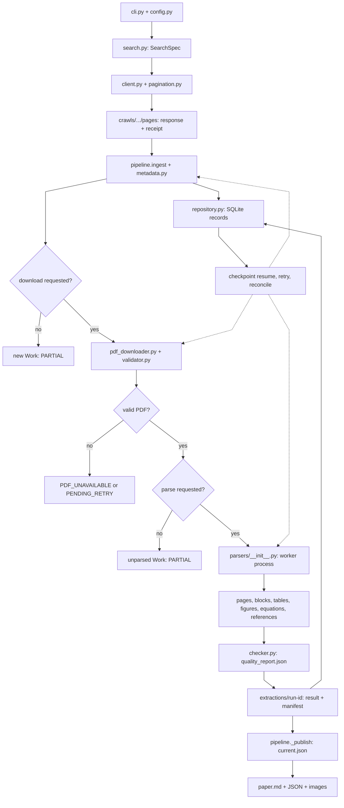
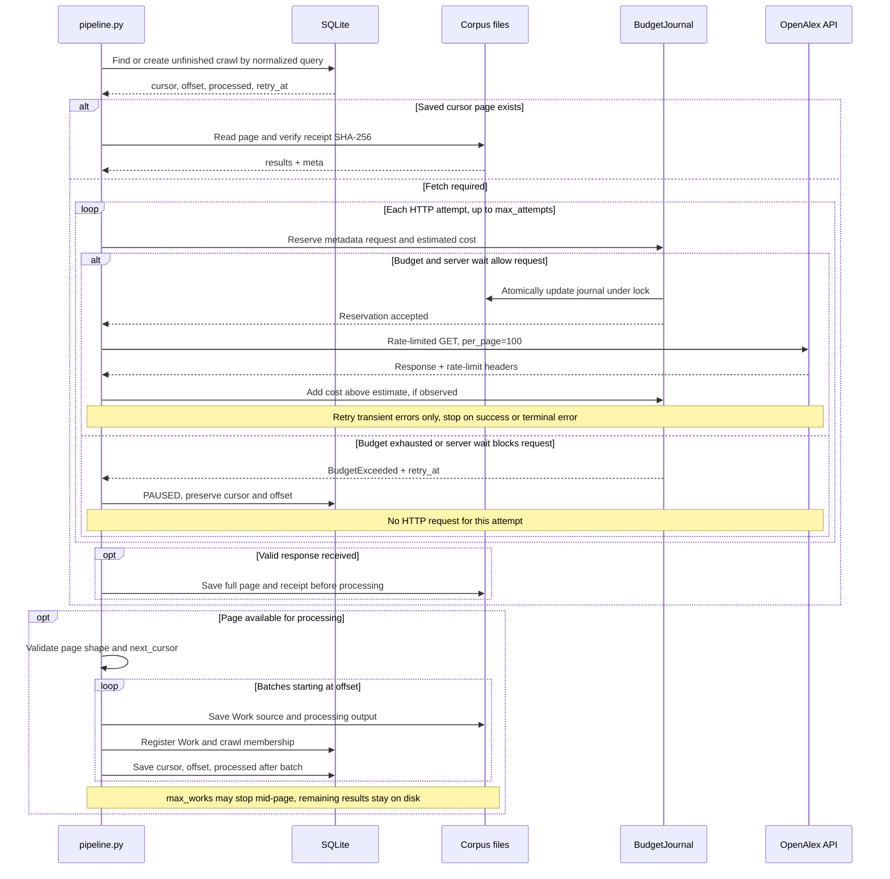
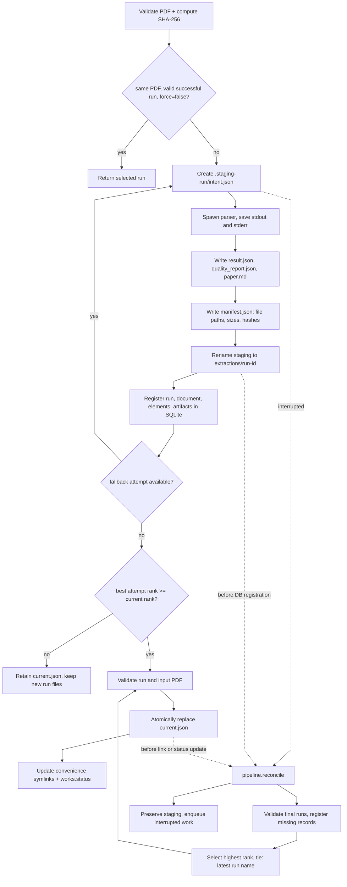
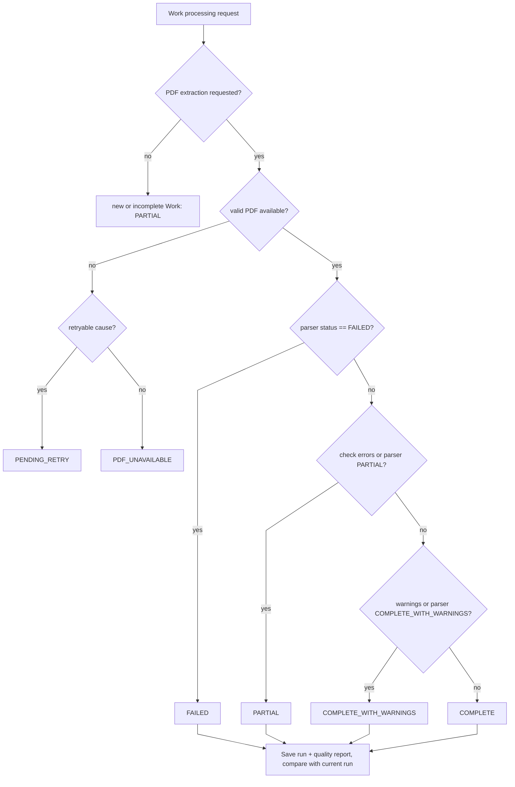
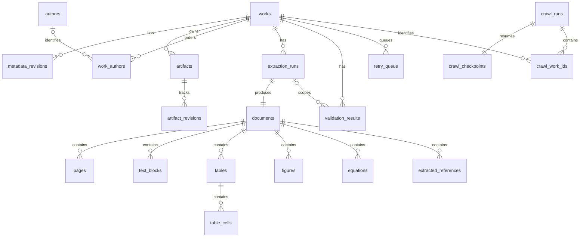

# Collection, extraction, and recovery architecture

OpenAlex Corpus collects Work metadata and accessible PDFs into a local corpus. It keeps the source files, parser outputs, extraction candidates, and failure records alongside the generated Markdown. A result marked `COMPLETE` has passed the implemented checks; that status does not establish that every part of the PDF was reconstructed correctly.

This document describes the current implementation. See the [README](../README.md) for commands, [DATABASE](DATABASE.md) for the storage schema, [API](API.md) for request and budget policy, [PARSERS](PARSERS.md) for extraction behavior, and [DEVELOPMENT_LOG](DEVELOPMENT_LOG.md) for the development and validation record.


## 1. Data flow and module boundaries



The arrows show data dependencies. Parsers produce independent evidence from the source, but their calls run in a defined sequence within one worker process. They do not all execute concurrently for a single document.

| Boundary | Implementation | Responsibility |
|---|---|---|
| User input | [cli.py](../src/openalex_corpus/cli.py), [config.py](../src/openalex_corpus/config.py) | Validate commands and configuration, acquire the corpus writer lock, format output |
| Search and HTTP | [search.py](../src/openalex_corpus/api/search.py), [client.py](../src/openalex_corpus/api/client.py), [pagination.py](../src/openalex_corpus/api/pagination.py) | Validate allowed filters, authenticate, reserve request budgets, check response shape and cursors |
| Coordination | [pipeline.py](../src/openalex_corpus/pipeline.py) | Process batches, save checkpoints, run workers, select results, recover interrupted work |
| Metadata and records | [metadata.py](../src/openalex_corpus/metadata.py), [repository.py](../src/openalex_corpus/database/repository.py) | Preserve source revisions, represent missing values, maintain normalized relationships and job records |
| PDF acquisition | [pdf_downloader.py](../src/openalex_corpus/download/pdf_downloader.py), [validator.py](../src/openalex_corpus/download/validator.py) | Build URL candidates, validate files, resume partial transfers, retain versions and provenance |
| Extraction | [parsers/__init__.py](../src/openalex_corpus/parsers/__init__.py) and parser adapters | Extract candidates from the source and compare parser outputs |
| Quality and recovery | [checker.py](../src/openalex_corpus/quality/checker.py), [recovery.py](../src/openalex_corpus/quality/recovery.py) | Check results, assign status, choose bounded fallback attempts |

## 2. Source preservation and provenance

### Work identity and metadata revisions

The corpus uses the OpenAlex `W…` ID as the Work key. DOIs are normalized for lookup but are not unique keys. Different Work IDs sharing a DOI remain separate records and are reported as possible duplicates. The pipeline does not merge their source data or histories based on the DOI alone.

Before normalization, each metadata payload is saved to `raw_responses/<payload-sha256>.json`. A response with an invalid or missing Work ID still leaves a raw file and a failure record. For a valid Work, the pipeline records the revision in `papers/W…/metadata_history/<payload-sha256>.json` and `metadata_revisions`, then updates the current `works` values, `metadata_raw.json`, and `metadata.json`. Files are written before the database update. If that sequence is interrupted, `metadata_pending.json` identifies the revision that reconciliation should ingest.

Two kinds of hashes serve different purposes:

- `raw_sha256` identifies a payload using sorted, compact JSON.
- Hashes in `artifacts` and extraction manifests are SHA-256 hashes of the actual file bytes.

A pretty-printed JSON file can therefore have a different file hash from its payload hash. A changed payload creates a revision without removing earlier revisions. Collecting an identical payload again does not create another copy of the same revision.

### Values, sources, and missing data

Normalization copies the source object and adds fields for querying and provenance. Unknown source fields remain in raw JSON. `null`, empty strings, and empty arrays retain their distinct meanings. An empty `title` is not filled from `display_name`. When an author or institution has no source ID, the relationship record leaves that ID empty instead of inventing an OpenAlex ID.

Field records include `source`, `source_field`, `retrieval_status`, `validation_status`, and `missing_reason`. They cover nested paths such as `authorships[0].author.orcid` and `locations[0].license`. A `present` status means the source supplied a value; it does not mean the value has been independently verified.

Abstract reconstruction follows the positions in OpenAlex's inverted index. Conflicting positions or gaps produce `abstract_text=null`, a `parse_failed` status, and the candidates for each position. The implementation does not fill missing words from context.

PDF and extraction records carry the same kind of provenance: URL, license, manuscript version, retrieval time, file hash, page number, bounding box, parser, and source text where available. A missing license, equation representation, caption, or reference identifier remains unresolved unless the source supplies sufficient evidence.

## 3. Cursor checkpoints and network budgets



A checkpoint stores both the current saved page's `cursor` and the number of entries already processed within it, `offset`. If a call processes 30 entries from a 100-entry page, it saves `offset=30`. The next call starts with entry 31 of that saved page.

`max_works` limits the current invocation and is excluded from crawl identity. An unfinished crawl can resume when its search parameters and PDF/Markdown processing options match. A completed crawl starts a new run.

Processing a Work and saving the batch checkpoint are separate operations. A crash between them can cause some Works to be processed again. Unique constraints on Work IDs, revisions, relationship rows, and crawl membership, together with validated caches, make this repeat processing safe for the stored records. External requests do not have an exactly-once guarantee.

The pagination code stops on a repeated cursor, a cycle through visited cursors, empty `results` with a continuation cursor, or an invalid offset. These conditions are not treated as successful completion. OpenAlex search results can change between requests, including their order and count. The final `coverage_audit` compares the number of collected unique Work IDs with the API's reported count, but a difference alone does not prove that records were missed. Saved pages preserve the responses received during the crawl, not a snapshot of the entire OpenAlex database.

### Limits and reset behavior

| Limit | Default | Scope and reset |
|---|---:|---|
| Metadata HTTP attempts | 1,000 | Per UTC day, shared by the same `data_dir` |
| Estimated metadata cost | USD 0.05 | Per UTC day, shared by the same `data_dir` |
| PDF download calls | 100 | Per downloader instance, counted for Works requiring network processing |
| OpenAlex content HTTP attempts | 0 | Cumulative for the same `data_dir`; no daily reset |
| Estimated OpenAlex content cost | USD 0 | Cumulative for the same `data_dir`; no daily reset |

Before network use, the client reserves budget in `state/network_budget.json`. A separate file lock serializes updates across processes. Failed requests, retries, and a process exit immediately after reservation all consume the reservation. Lower observed costs are not refunded; metadata response costs above the estimate are added to the journal.

The default content limits of zero block paid OpenAlex PDF requests until they are explicitly enabled. The downloader can still try other eligible OA URLs.

These are local request limits. They cannot account for another application, browser, or `data_dir`, and a service price increase may only become visible after the response arrives. They do not enforce an account-wide spending cap. [API](API.md) records the estimated prices and when they were checked. Deleting the budget journal removes the history used to enforce cumulative limits; an unreadable journal blocks requests.

The metadata client reads `OPENALEX_API_KEY` from the environment and sends it in a Bearer authorization header. The key is not a configuration-file field. Error strings and download provenance redact sensitive values. Anonymous pagination beyond the first page stops locally with `API_KEY_REQUIRED`. Authentication failures, permission failures, and malformed responses do not receive the same retry treatment as transient network errors. A long `Retry-After` pauses work with a recorded resume time instead of keeping the process waiting indefinitely.

## 4. PDF acquisition and parser execution

### Downloaded source files

The downloader builds candidates from the OpenAlex content URL, `best_oa_location`, `primary_location`, and additional OA locations, in that order, removing duplicate URLs. It uses the first eligible candidate that yields a valid PDF. It does not download every URL or every manuscript version. Ordinary-host candidates explicitly marked non-OA, and candidates excluded by a configured license allowlist, are skipped. An absent source license is recorded as absent.

Downloads go to `.part` files. After checking size, response properties, and PDF structure, the downloader preserves the file at `pdf_versions/<sha256>.pdf`. The first source PDF also remains at `original.pdf`. If the same URL later returns different bytes, the new bytes become a separate version. `download_manifest.json` retains the retrieval history.

A cached version is reused only after checking its relationship to the current candidate URLs, validating the PDF, and matching its recorded SHA-256. Setting `refresh_existing` does not bypass request, cost, or size limits.

Resuming a partial transfer requires an ETag or Last-Modified validator and a matching Content-Range. If the server ignores Range, the transfer restarts safely. A user-supplied PDF without download provenance is marked `unverified`; no source URL is fabricated for it. Download failures leave the collected metadata intact.

### Execution order within a worker

1. **PyMuPDF** inspects every page of the source PDF. It records text blocks, spans, coordinates, displayed images, image resources, equation candidates, and page renders. A page that cannot be loaded still has a failure record with its page number.
2. Pages with visible content but no text, or sparse text, are marked `ocr_required`. When OCR is enabled and the required executables are available, **OCRmyPDF/Tesseract** processes the selected pages into a separate PDF. The adapter checks that the source hash has not changed and that the derived PDF has the expected page count. Its current language is `eng`; it does not detect arbitrary languages automatically.
3. **pdfplumber and PyMuPDF table detection** produce independent table candidates and page text for comparison. When the OCR-derived PDF is used, character and cell evidence from the affected pages is marked `ocr_extracted`.
4. The **Docling standard pipeline** produces structure, headings, reading order, table candidates, and figure regions. Missing models or parser failures are recorded, and processing continues with the available PyMuPDF/pdfplumber output. Even when Docling succeeds, a substantial page-level content disagreement can cause Markdown for that page to use the retained PyMuPDF candidate.
5. The parser extracts source reference sections and adds structured references from a configured **GROBID service or supplied TEI file**. GROBID runs as a separate service and supplements the native PDF parsers. The TEI source and reference candidates are retained.

The relevant implementations are the [parser coordinator](../src/openalex_corpus/parsers/__init__.py), [PyMuPDF adapter](../src/openalex_corpus/parsers/pymupdf_parser.py), [table parser](../src/openalex_corpus/parsers/table_parser.py), [Docling adapter](../src/openalex_corpus/parsers/docling_parser.py), [OCR adapter](../src/openalex_corpus/parsers/ocr.py), and [GROBID adapter](../src/openalex_corpus/parsers/grobid_parser.py).

Table records preserve cell values, row and column positions, merged cells, empty values, and `null`. Outputs include CSV, JSON, HTML, Markdown, and region images. Overlapping candidates share a `candidate_group_id`, but conflicting values are not merged into one answer. `cell_matrix_agreement` compares cell matrices after whitespace normalization. It does not verify the meaning of headers, units, or captions.

Figure records distinguish an `image_object` from a `figure_region`. One published figure can appear in both forms, so the number of candidates is not the number of figures in the paper. A page render can preserve vector content even when the parser cannot isolate each vector figure.

### Equations and unresolved content

Equation detection uses character, font, and layout evidence. Without verified LaTeX, the parser saves `latex=null`, `equation_parse_failed`, and an image of the source region. A small, fixed set of substitutions for observed Unicode characters may produce a `latex_candidate`, which remains `unverified`. The parser does not infer superscripts, subscripts, fractions, integrals, or matrix layout.

The parser coordinator currently treats the presence of any equation candidate as unresolved content and assigns `PARTIAL`. Equation-heavy papers can therefore remain `PARTIAL` even when much of their text and structure has been extracted successfully. The permitted substitutions and their limitations are documented in [equation_parser.py](../src/openalex_corpus/parsers/equation_parser.py) and [PARSERS](PARSERS.md).

The Docling adapter explicitly disables its OCR, picture descriptions, code and formula generation, chart-value extraction, external services, and external plugins. This extraction path does not use a VLM or LLM to generate prose, captions, or measurements. OCR runs only through the separately enabled OCR adapter.

GROBID's consolidation options are all set to zero, disabling automatic external metadata enrichment. A DOI found by regular expression is stored as `doi_candidate`. A reference is linked to a Work only when verified, exact identifier evidence supports the link; title similarity does not establish one. If the OpenAlex and TEI titles differ, both values remain and a warning records the disagreement.

## 5. Immutable extraction runs and recovery



Every extraction writes a new run directory. It never overwrites a previous run. The pipeline finalizes staging with an atomic directory rename and then registers the run in SQLite. `record_extraction()` returns the existing record when called again with the same run ID, Work, path, result, and quality report. Reusing a run ID with different content raises an error. Immutability is enforced by this storage policy and hash validation; the pipeline does not set operating-system read-only permissions on run files.

`manifest.json` records the input PDF path and hash, parser options, run status, and generated files with their paths, sizes, and hashes. The manifest's own hash is stored separately as a database artifact.

`current.json` is the authoritative pointer to the selected run. Files such as `paper.md` and directories such as `tables/` at the paper root are convenience symlinks into that run. Reconciliation can recreate them after an interruption. It does not delete a user-owned ordinary directory that occupies one of those names.

The quality order is:

```text
COMPLETE > COMPLETE_WITH_WARNINGS > PARTIAL > FAILED / PENDING_RETRY
```

A lower-ranked new result does not replace the current selection. An equal-ranked new result may replace it. Within a single parse call, however, the first attempt at the best rank is retained when later fallback attempts tie. `reconcile` considers all valid final run directories, selects the highest rank, and breaks ties using the latest run name in lexical order.

Quality rank says nothing about manuscript version or publication recency. A higher-quality extraction of an older PDF can remain selected after a newer PDF produces a lower-quality extraction. Use the PDF hash in `current.json` together with the download history to identify the selected source.

Filesystem updates and SQLite commits are not one atomic transaction. `reconcile` uses the source files, intent, manifest, and result to repair interruptions between them. A valid final directory can be registered again without duplicating its records. An unfinished `.staging-*` directory is preserved and queued for retry; it is never promoted to a successful run merely because it exists. Damaged runs are skipped or reported as errors. Check the reconciliation result and any subsequent retry results for work that remains unresolved.

## 6. Status assignment and verification



This is the usual flow for a new or incomplete Work. A Work with a valid successful result can retain its stored status and selected extraction after a failed download refresh or a lower-quality reparse. The latest operation's return value, `download_jobs` or `parse_jobs` status, `extraction_runs.status`, and `works.status` describe different things and can legitimately differ.

| Work status | Meaning |
|---|---|
| `COMPLETE` | The selected result passed the implemented page coverage, Markdown, file-reference, and other checks, with no known warnings |
| `COMPLETE_WITH_WARNINGS` | The result has no check errors, but has warnings such as reading-order uncertainty, parser disagreement, or unverified candidates |
| `PARTIAL` | Only metadata/PDF storage was requested, or unresolved extraction, OCR, equation, element, or integrity issues remain |
| `FAILED` | The parser returned a failed result, or a worker failure was recorded as a failed extraction run |
| `PDF_UNAVAILABLE` | No usable PDF was obtained from the current candidates under the access policy, and the outcome was not classified for retry |
| `PENDING_RETRY` | A transient download failure, budget/request limit, processing exception, or similar condition requires another attempt |

`PARTIAL` is not a simple measure of failed collection. Successfully collecting metadata for 100 new Works creates 100 `PARTIAL` Works with reason `pdf_not_requested`. Stopping after PDF storage uses `markdown_not_requested` for an unparsed Work. These states distinguish metadata or file acquisition from completed PDF extraction. Similarly, `PDF_UNAVAILABLE` describes the attempted access paths, not the absence of a PDF everywhere.

[check_extraction()](../src/openalex_corpus/quality/checker.py) checks the actual page set against expected page numbers, duplicate pages, failed pages, unresolved regions, empty Markdown, and local image references. It also reports short Markdown, repeated sentences, Unicode replacement characters, unverified equations and tables, and parser warnings. Check errors or a parser `PARTIAL` status produce `PARTIAL`; warnings alone produce `COMPLETE_WITH_WARNINGS`. A parser `FAILED` status is preserved.

There are two relevant layers for equations: the parser treats any equation candidate as `PARTIAL`, while the checker's `EQUATION_UNVERIFIED` finding is a warning. Read both the parser result and the quality report when tracing the assigned status. Likewise, `no_detected_failures` means the checks found no failure; it does not establish that an element was absent or perfectly extracted.

`verify` rechecks actual file existence and hashes, then checks the selected extraction's structure. A failure can change the Work to `PARTIAL` and queue reprocessing. Existing database rows, passing SQLite integrity/foreign-key checks, and a registered manifest are not substitutes for checking the current file bytes. None of these checks validates the paper's claims or mathematical correctness.

## 7. Resource limits and retry layers

The CLI acquires `state/writer.lock`, allowing one writer at a time for a corpus. SQLite uses WAL, foreign keys, `synchronous=FULL`, and a 30-second busy timeout. Repository transactions use `BEGIN IMMEDIATE`; nested calls use savepoints. Reads can continue during collection. Code calling the library outside the CLI must coordinate its own writers.

Document batches are bounded by `download.concurrency`, with an asynchronous lock for each Work. Parser execution uses a `parsing.workers` semaphore and one `spawn` process per document. Each worker saves stdout and stderr to files so native-library diagnostics do not corrupt the CLI's JSON output.

The [bundled YAML](../config/config.yaml) sets download concurrency to 3, parser workers to 1, the worker memory budget to 3,072 MB, and the overall parser timeout to 600 seconds. The configuration model's `worker_memory_mb` default is 2,048 MB, so the effective value depends on whether the YAML is loaded.

The parent checks elapsed time and the combined RSS of the parser and its descendants about every 0.2 seconds, terminating them when a limit is exceeded. This is a sampled limit, not an instantaneous operating-system memory cap. A separately running GROBID server is outside that process tree and memory accounting.

Docling has a separate document timeout. OCR runs with `--jobs 1` and terminates its process group on timeout. Configuration rejects `workers × worker_memory_mb > memory_limit_mb`, but that calculation does not bound the whole machine's memory use.

| Retry layer | Behavior and limit |
|---|---|
| HTTP | Metadata requests default to at most 4 attempts; each PDF candidate defaults to at most 3. Only transient failures receive exponential backoff, jitter, and bounded Retry-After handling. |
| Parser fallback for one PDF | `max_recovery_attempts` defaults to 2. Certain page/OCR errors may select PyMuPDF with OCR enabled; other cases may disable Docling. Processing stops immediately if no alternative options apply. |
| Persistent retry queue | One row per Work and stage. Re-enqueuing preserves the highest consumed attempt count. CLI retry processing observes the resume time and `retry_max_attempts`, which defaults to 3. |

Fallback attempts cannot supply missing source information or guarantee a correct equation. If the same limitations remain, the run retains its `PARTIAL` status and evidence. `retry_queue` is a local record of pending work; the application does not run a continuous scheduler or distributed worker service.

## 8. Database relationships and file layout



The diagram shows the main relationships. Institutions, sources, locations, topics, identifiers, OpenAlex reference links, jobs, errors, and checksum tables are covered by the [full schema](../src/openalex_corpus/database/migrations/001_initial.sql) and [DATABASE](DATABASE.md).

The `extraction_runs`–`documents` one-to-one relationship describes normal registration; SQLite enforces uniqueness on the document's run foreign key. Element tables reference `document_id` and store a `page_number`, which is why the diagram does not draw foreign-key relationships from individual pages to elements. An author relationship can have no `authors` record when the source supplies no author ID.

Relational columns support filtering and aggregation. `payload_json`, `result_json`, and `quality_json` preserve evidence that does not fit those fixed columns. Metadata entity and relationship tables represent the current projection; source revisions preserve earlier context. Extraction records belong to a run, so reparsing does not modify earlier page or table records. SQLite is the only implemented backend; changing a connection string does not enable PostgreSQL.

```text
data/
├── database/corpus.sqlite
├── state/
│   ├── writer.lock
│   ├── network_budget.lock
│   └── network_budget.json
├── raw_responses/<payload-sha256>.json
├── crawls/<crawl-id>/pages/
│   ├── <cursor-sha256>.json
│   └── <cursor-sha256>.receipt.json
└── papers/W…/
    ├── metadata_history/<payload-sha256>.json
    ├── metadata_raw.json
    ├── metadata.json
    ├── original.pdf
    ├── pdf_versions/<pdf-sha256>.pdf
    ├── download_manifest.json
    ├── download_report.json
    ├── current.json
    ├── paper.md -> extractions/<selected-run>/paper.md
    └── extractions/<run-id>/
        ├── intent.json
        ├── parser_stdout.log / parser_stderr.log
        ├── result.json / document.json / pages.json
        ├── quality_report.json / manifest.json
        ├── paper.md / paper_body.md
        ├── pymupdf_raw.json / pdfplumber_raw.json
        ├── docling_* / grobid.tei.xml / tei_document.json
        └── page_images/ / tables/ / figures/ / equations/ / ocr/
```

This tree includes optional outputs. A metadata-only Work has no downloaded PDF, and an optional parser that did not run leaves no output from that adapter. Consult the run result and manifest for the files and evidence actually available.

`document.json` is written by the parser. The pipeline later adds the run ID, input PDF hash, metadata comparisons, and other context to `result.json`; the two files need not be identical.

Database backups use SQLite's online backup API followed by integrity checks. Copying only the database file during WAL writes is unsafe. PDFs and extraction files require separate backup alongside the database. Model files, model manifests, dependency lock files, and configuration are also needed for long-term reproducibility.

## 9. Limits of the architecture

The implementation preserves source data and parser evidence, records uncertainty, bounds resource use, and supports repeated registration and recovery after interruptions. Several limits remain:

- Saved API pages record the responses actually received. A later search can return different results, and a full OpenAlex snapshot collector is not implemented.
- Extraction depends on the PDF, models, native libraries, and OCR versions. Identical configuration alone does not guarantee byte-identical output.
- Multi-column reading order, complex tables, scanned text, vector-figure separation, and equation detection can produce false positives or missed content. Some results require comparison with the source and alternate candidates.
- `COMPLETE` covers the implemented checks. Undetected omissions, errors in the source, and the validity of the paper's claims remain outside that status.
- Filesystem changes and database commits require reconciliation if interrupted. Recovery depends on the retained intent, result, and hash records and reports damaged evidence as unresolved.
- A failed latest attempt can coexist with a valid selected result. Job logs, individual run statuses, `current.json`, and the Work status each answer a different operational question.

See [TEST_MATRIX](TEST_MATRIX.md), [VALIDATION](VALIDATION.md), and [ENHANCED_VALIDATION](ENHANCED_VALIDATION.md) for test coverage and recorded execution evidence.
