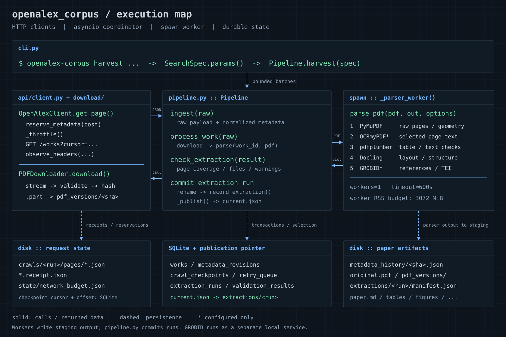
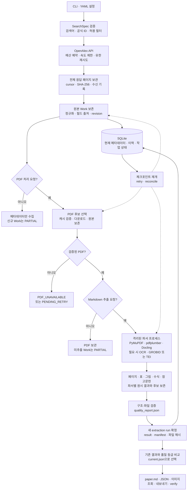
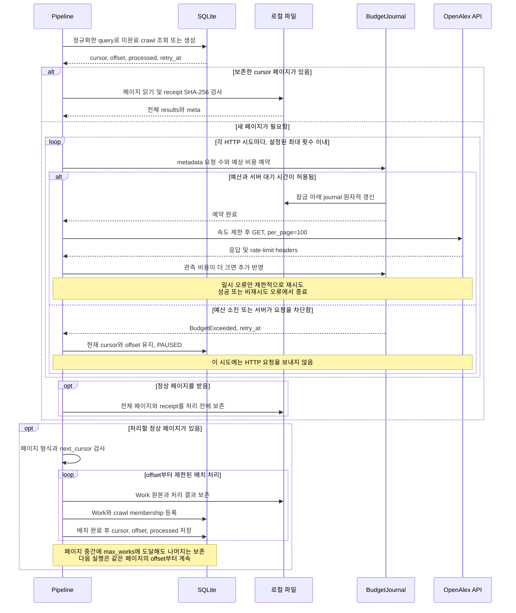
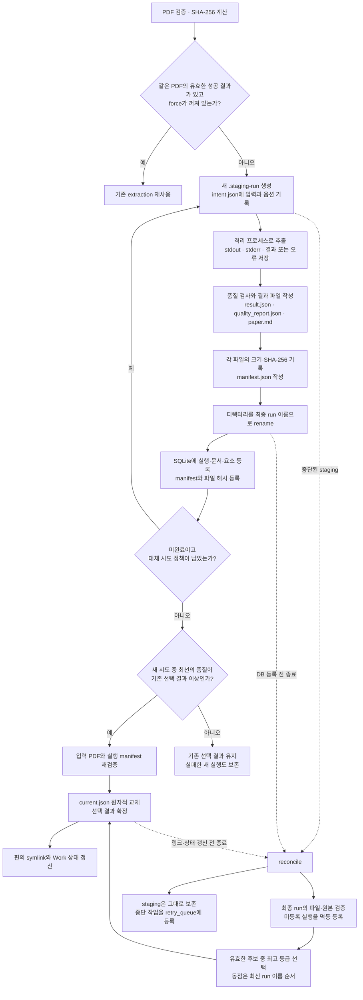
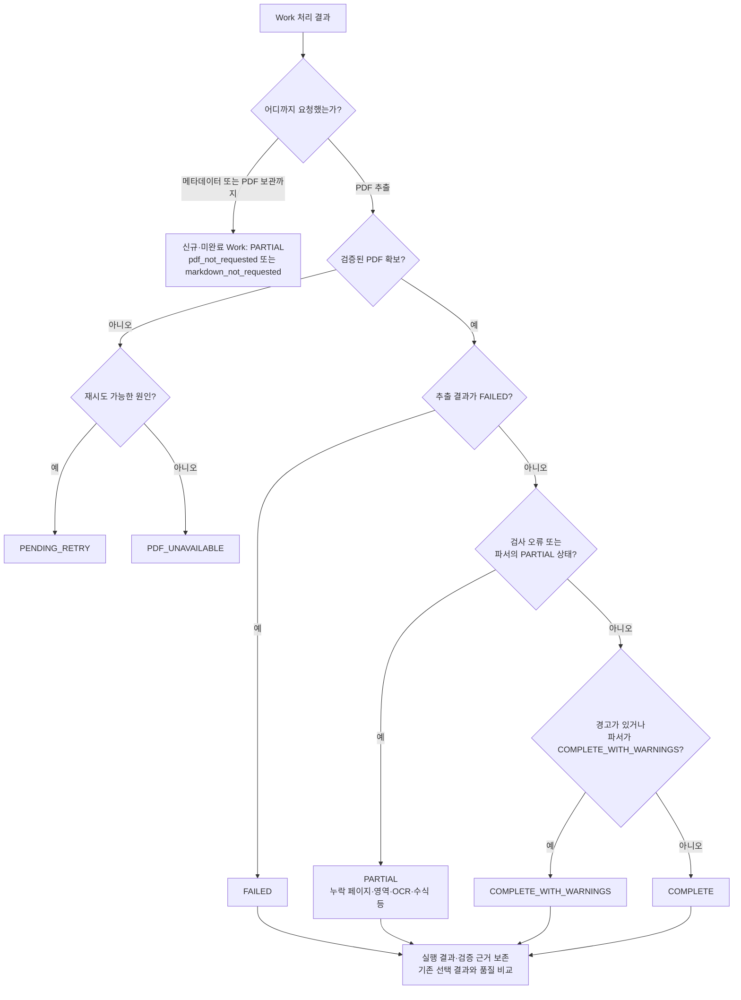
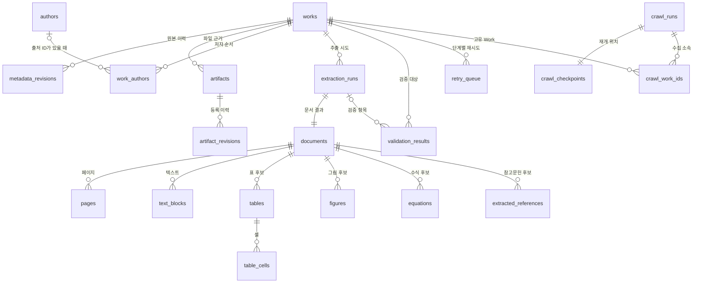

# 수집·추출·복구 아키텍처

이 프로그램은 OpenAlex의 논문 메타데이터와 접근 가능한 PDF를 수집하고, 원본과 추출 근거를 함께 보관하는 로컬 코퍼스 도구입니다. 읽기 쉬운 Markdown을 만들면서도 원문, 파서별 후보, 불확실한 영역, 실패 기록을 따라갈 수 있도록 설계했습니다. `COMPLETE`는 정의된 자동 검사를 통과했다는 상태이며, PDF의 모든 의미와 레이아웃이 정확하게 복원되었다는 보증은 아닙니다.

이 문서는 현재 구현의 데이터 흐름과 장애 복구 원리를 설명합니다. 실행 방법은 [README](../README.md), 세부 저장 스키마는 [DATABASE](DATABASE.md), 요청·예산 정책은 [API](API.md), 추출 방식은 [PARSERS](PARSERS.md), 실제 개발·검증 과정은 [DEVELOPMENT_LOG](DEVELOPMENT_LOG.md)를 참고하십시오.



## 1. 전체 데이터 흐름과 책임 분리



화살표는 데이터 의존성을 나타냅니다. 여러 파서가 독립적인 추출 근거를 만든다는 뜻이지, 한 문서의 모든 파서가 동시에 실행된다는 뜻은 아닙니다. 실제 파서 호출은 하나의 작업 프로세스 안에서 정해진 순서로 진행됩니다.

| 경계 | 담당 구현 | 책임 |
|---|---|---|
| 사용자 입력 | [cli.py](../src/openalex_corpus/cli.py), [config.py](../src/openalex_corpus/config.py) | 명령·설정 검증, 코퍼스 쓰기 잠금, 출력 |
| 검색·통신 | [search.py](../src/openalex_corpus/api/search.py), [client.py](../src/openalex_corpus/api/client.py), [pagination.py](../src/openalex_corpus/api/pagination.py) | 허용 필터, 인증, 요청 예산, 응답 구조와 cursor 검사 |
| 조정 | [pipeline.py](../src/openalex_corpus/pipeline.py) | 배치 처리, 체크포인트, 프로세스 실행, 결과 선택, 중단 복구 |
| 원본·관계 저장 | [metadata.py](../src/openalex_corpus/metadata.py), [repository.py](../src/openalex_corpus/database/repository.py) | 원본 이력, 명시적인 결측 상태, 정규화 관계, 작업 기록 |
| PDF 획득 | [pdf_downloader.py](../src/openalex_corpus/download/pdf_downloader.py), [validator.py](../src/openalex_corpus/download/validator.py) | 후보 URL, 파일 검증, 부분 전송, 버전·출처 보존 |
| 내용 추출 | [parsers/__init__.py](../src/openalex_corpus/parsers/__init__.py)와 개별 어댑터 | 원문 기반 후보 추출과 교차 비교 |
| 판정·회복 | [checker.py](../src/openalex_corpus/quality/checker.py), [recovery.py](../src/openalex_corpus/quality/recovery.py) | 검증 항목, 상태, 제한된 파서 대체 시도 |

## 2. 원본 보존과 provenance

### 같은 Work의 변화와 다른 Work의 중복을 구분한다

코퍼스의 식별자는 OpenAlex의 `W…` ID입니다. DOI는 정규화하여 조회하지만 유일 키로 강제하지 않습니다. 같은 DOI를 가진 여러 Work ID는 각각 보관하고 중복 후보로 보고합니다. DOI만으로 두 논문의 원본이나 이력을 자동 병합하지 않습니다.

메타데이터는 정규화 전에 `raw_responses/<payload-sha256>.json`으로 보존합니다. Work ID를 해석하지 못한 응답도 이 위치와 실패 기록에 남습니다. 유효한 Work는 `papers/W…/metadata_history/<payload-sha256>.json`과 `metadata_revisions`에 원본 revision을 추가합니다. 이후 `works`의 현재 값과 `metadata_raw.json`, `metadata.json`을 갱신합니다. 원본 파일을 쓴 뒤 DB를 갱신하므로 중간에 종료되면 `metadata_pending.json`을 근거로 재조정할 수 있습니다.

`raw_sha256`은 정렬된 compact JSON으로 계산한 **payload 식별 해시**입니다. `artifacts`와 manifest에 저장하는 해시는 **실제 파일 바이트의 SHA-256**입니다. JSON 공백·들여쓰기 때문에 두 해시가 달라도 모순은 아닙니다. 새 payload가 같은 Work의 현재 값을 바꾸어도 과거 revision은 남습니다. 반면 완전히 동일한 payload의 반복 수집은 revision을 매번 늘리지 않습니다.

### 값, 출처, 상태를 함께 저장한다

정규화는 원본 객체를 복사한 뒤 조회용 필드와 출처 정보를 추가합니다. 알 수 없는 원본 필드는 raw JSON에 남고, `null`, 빈 문자열, 빈 배열을 같은 값으로 바꾸지 않습니다. `title`이 비어 있다는 이유로 `display_name`을 대신 넣지 않습니다. 저자·기관 ID가 없으면 연결 행의 ID를 비워 두고 가상의 OpenAlex ID를 만들지 않습니다.

필드 상태에는 `source`, `source_field`, `retrieval_status`, `validation_status`, `missing_reason` 등이 포함됩니다. `authorships[0].author.orcid`와 `locations[0].license`처럼 중첩 경로도 기록합니다. `present`는 출처에 값이 있다는 뜻이며, 사실 검증 완료를 의미하지 않습니다. 원문 초록의 역색인 위치가 충돌하거나 중간에 비어 있으면 `abstract_text=null`, `parse_failed`와 위치별 후보를 저장합니다. 빠진 단어를 문맥으로 채우지 않습니다.

PDF와 추출 요소에서도 같은 원칙을 적용합니다. URL·license·manuscript version·수신 시각·파일 해시, 페이지 번호·좌표·파서·원문 문자열을 보관합니다. 원본에서 제공하지 않은 license나 수식, 캡션, 참고문헌 식별자를 추측해서 확정하지 않습니다.

## 3. cursor 재개와 네트워크 예산



체크포인트는 다음 페이지 cursor 하나만 저장하지 않습니다. 현재 보존 페이지의 cursor와 그 안에서 처리한 항목 수인 `offset`을 함께 저장합니다. 예를 들어 100개짜리 페이지에서 30개만 처리한 실행은 `offset=30`으로 끝나며, 재개 시 같은 페이지의 31번째 항목부터 진행합니다. `max_works`는 이번 호출의 처리 한도이며 crawl의 식별 조건에는 포함하지 않습니다. 검색 파라미터와 PDF·Markdown 처리 옵션이 같은 미완료 crawl을 이어 가고, 완료된 crawl은 새 실행으로 시작합니다.

Work 처리와 배치 체크포인트 갱신 전체가 하나의 거대한 트랜잭션인 것은 아닙니다. 그 사이에 종료되면 일부 Work를 다시 볼 수 있습니다. Work ID·revision·연결 행·crawl membership의 유일 제약과 검증된 캐시가 반복 처리를 견딥니다. 동일 데이터의 논리적 중복 등록을 방지하는 구조이며, 모든 외부 요청을 반드시 한 번만 실행한다는 보장은 아닙니다.

동일 cursor 반복, 이미 방문한 cursor로의 순환, 빈 results와 continuation cursor의 조합, 잘못된 offset은 완료로 간주하지 않고 중단합니다. 검색 결과는 실시간 데이터이므로 재질의하면 순서와 개수가 달라질 수 있습니다. 마지막 `coverage_audit`는 실제 고유 Work ID 수와 API 보고 수를 비교하지만, 차이를 곧바로 누락의 증거로 단정하지 않습니다. 저장한 응답은 재현에 도움이 되지만 OpenAlex 전체의 시점 고정 snapshot은 아닙니다.

### 적용 범위가 다른 제한

| 제한 | 기본값 | 범위·리셋 |
|---|---:|---|
| 메타데이터 HTTP 시도 수 | 1,000회 | 같은 `data_dir`의 UTC 날짜별 누계 |
| 메타데이터 예상 비용 | USD 0.05 | 같은 `data_dir`의 UTC 날짜별 누계 |
| PDF 작업 호출 수 | 100개 | downloader 인스턴스별, 네트워크 처리가 필요한 Work 기준 |
| OpenAlex content HTTP 시도 수 | 0회 | 같은 `data_dir`의 누적 한도, 일일 리셋 없음 |
| OpenAlex content 예상 비용 | USD 0 | 같은 `data_dir`의 누적 한도, 일일 리셋 없음 |

네트워크 사용 전에 `state/network_budget.json`에 예약을 기록하고 별도 파일 잠금으로 프로세스 간 갱신을 직렬화합니다. 실패·재시도·예약 직후의 종료도 예약을 소비하며, 실제 관측 비용이 예상보다 낮다고 환불하지 않습니다. 메타데이터 응답의 관측 비용이 높으면 차액을 더합니다. 기본 content 한도가 0이므로 OpenAlex의 과금 대상 PDF 요청은 명시적으로 허용하기 전에는 수행하지 않습니다. 다른 OA URL의 시도는 별도로 진행할 수 있습니다.

이 장치는 로컬 요청 제한입니다. 다른 프로그램·브라우저·다른 `data_dir`의 사용량을 알 수 없고, 외부 서비스가 가격을 올리면 응답을 받은 뒤에야 관측할 수 있습니다. 계정 전체의 결제 차단 장치는 아닙니다. 예상 단가와 확인 시점은 [API](API.md)에 기록하며, budget journal을 지우면 누적 제한의 근거도 사라집니다. 읽을 수 없는 journal은 요청을 허용하지 않습니다.

인증 키는 `OPENALEX_API_KEY` 환경변수에서 읽고 메타데이터 요청의 Bearer 헤더로 전달합니다. 설정 파일에 저장하지 않으며 오류 문자열·다운로드 출처에서는 민감한 값을 가립니다. 익명으로 첫 페이지 이후를 요청하면 로컬에서 `API_KEY_REQUIRED`로 멈춥니다. 인증·권한 오류와 잘못된 응답은 일시 네트워크 오류처럼 무조건 재시도하지 않습니다. 긴 `Retry-After`는 무한 대기 대신 재개 시각을 기록한 중단으로 처리합니다.

## 4. PDF 획득과 독립적인 추출 근거

### 원본 다운로드

PDF 후보는 OpenAlex content URL, `best_oa_location`, `primary_location`, 추가 OA location에서 순서대로 구성하며 URL 중복을 제거합니다. 실제로는 허용된 후보 중 처음 성공한 PDF를 사용합니다. 모든 버전·모든 URL을 무조건 받는 수집기가 아닙니다. 비-OA로 명시된 일반 호스트와 설정한 license allowlist에 맞지 않는 후보는 건너뜁니다. 출처에 license가 없으면 그 사실을 남깁니다.

다운로드는 `.part`에 쓰고 크기·응답·PDF 구조를 검증한 뒤 `pdf_versions/<sha256>.pdf`로 보관합니다. 첫 원본 `original.pdf`는 별도로 유지합니다. URL이 같아도 나중에 바이트가 달라지면 새 버전으로 남고, 다운로드 manifest는 수신 이력을 보존합니다. 기존 버전은 현재 후보 URL과의 관계, PDF 검증, 기록된 SHA-256 일치를 확인한 뒤 재사용합니다. 명시적인 `refresh_existing`도 요청·비용·크기 제한을 우회하지 않습니다.

부분 전송 재개에는 ETag 또는 Last-Modified와 일치하는 Content-Range가 필요합니다. 서버가 Range를 무시하면 안전하게 다시 시작합니다. 출처 없이 사용자가 넣은 기존 PDF는 URL을 만들어 붙이지 않고 `unverified` 출처로 구분합니다. 실패해도 이미 보관한 메타데이터는 남습니다.

### 파서의 실제 실행 순서

1. **PyMuPDF**가 원본 PDF의 모든 페이지를 조사합니다. 텍스트 블록·span·좌표, 표시된 이미지, 이미지 리소스, 수식 후보, 페이지 렌더링을 보존합니다. 페이지 로드 실패도 해당 페이지 번호의 실패 레코드로 남깁니다.
2. 시각 내용이 있지만 텍스트가 없거나 희박한 페이지를 `ocr_required`로 분류합니다. OCR이 설정되어 있고 실행 파일이 있으면 **OCRmyPDF/Tesseract**가 선택한 페이지만 별도 PDF로 처리합니다. 원본 해시 불변과 페이지 수를 다시 확인합니다. 현재 어댑터의 OCR 언어는 `eng`이며 임의 언어를 자동 판별하지 않습니다.
3. **pdfplumber와 PyMuPDF 표 탐지**가 독립적인 표 후보와 비교용 페이지 텍스트를 만듭니다. OCR 파생 PDF를 사용한 경우 해당 페이지의 문자·셀 근거를 `ocr_extracted`로 표시합니다.
4. **Docling standard pipeline**이 구조·제목·읽기 순서·표·그림 영역 후보를 만듭니다. 모델이 없거나 실패하면 이유를 기록하고 기존 PyMuPDF/pdfplumber 결과로 진행합니다. Docling이 존재해도 페이지별 내용 불일치가 크면 해당 페이지의 Markdown은 보존된 PyMuPDF 후보를 사용할 수 있습니다.
5. 원문 참고문헌 구역을 추출하고, 설정된 **GROBID 또는 제공 TEI**의 구조화 참고문헌을 추가합니다. GROBID는 별도 서비스이며 네이티브 PDF 파서의 대체물이 아닙니다. 원본 TEI와 후보를 모두 남깁니다.

근거 코드는 [파서 조정](../src/openalex_corpus/parsers/__init__.py), [PyMuPDF](../src/openalex_corpus/parsers/pymupdf_parser.py), [표](../src/openalex_corpus/parsers/table_parser.py), [Docling](../src/openalex_corpus/parsers/docling_parser.py), [OCR](../src/openalex_corpus/parsers/ocr.py), [GROBID](../src/openalex_corpus/parsers/grobid_parser.py)에 있습니다.

표는 셀 값·행열 위치·병합·빈 값·`null`을 유지하고 CSV/JSON/HTML/Markdown과 영역 이미지를 저장합니다. 겹치는 후보는 `candidate_group_id`로 연결하지만 서로 다른 값을 하나로 합치지 않습니다. `cell_matrix_agreement`는 공백을 정규화한 셀 행렬의 일치이며, 헤더 의미·단위·캡션의 검증까지 뜻하지 않습니다.

그림의 `image_object`와 `figure_region`은 서로 다른 개념입니다. 같은 논문 그림이 두 기록으로 나타날 수 있으므로 후보 수를 논문의 실제 Figure 수로 해석하면 안 됩니다. 페이지 이미지가 벡터 내용을 보존해도 모든 벡터 그림이 독립적인 Figure로 분리되는 것은 아닙니다.

### 불확실한 수식을 만들지 않는 원칙

수식 탐지는 문자·글꼴·레이아웃 후보에 기반합니다. 검증된 LaTeX가 없으면 `latex=null`, `equation_parse_failed`와 원문 영역 이미지를 남깁니다. 관측된 Unicode 문자에 대한 매우 제한적인 고정 치환만 `latex_candidate`로 보관하며, 그 후보도 `unverified`입니다. 지수·첨자·분수·적분·행렬 배치를 추측하지 않습니다. 현재 파서 조정기는 수식 후보가 하나라도 있으면 미해결 요소로 보아 `PARTIAL`로 둡니다. 따라서 수식이 많은 논문에서 PARTIAL은 의도된 보수적 판정일 수 있습니다.

Docling의 OCR·그림 설명·코드/수식 생성·차트 값 추출·외부 서비스·외부 플러그인 기능은 명시적으로 비활성화합니다. 이 경로는 VLM/LLM으로 문장·캡션·측정값을 생성하지 않습니다. OCR은 별도 명시적 어댑터에서만 실행합니다. [equation_parser.py](../src/openalex_corpus/parsers/equation_parser.py)와 [PARSERS](PARSERS.md)에 허용된 치환과 한계가 있습니다.

GROBID 요청의 consolidation 옵션도 모두 0으로 두어 외부 메타데이터 자동 보완을 막습니다. 정규식 DOI는 `doi_candidate`이고, 참고문헌의 Work 연결은 검증된 정확한 식별자 근거가 있을 때만 저장합니다. 제목 유사도로 확정하지 않습니다. OpenAlex 제목과 TEI 제목이 다르면 두 값을 보존하고 경고를 남깁니다.

## 5. 불변 추출 실행과 결과 선택·복구



추출은 이전 디렉터리를 덮어쓰지 않고 매번 새 run에 기록합니다. 원자적 rename으로 staging을 최종 디렉터리로 확정한 뒤 DB에 등록합니다. `record_extraction()`은 같은 run ID·Work·경로·결과·품질 보고서를 다시 전달받으면 기존 실행을 반환합니다. 같은 run ID로 다른 결과를 쓰려고 하면 오류를 냅니다. 여기서 불변은 저장·재사용 정책과 해시 검사로 지키는 성질이며, 운영체제의 읽기 전용 파일 권한을 설정한다는 뜻은 아닙니다.

`manifest.json`에는 입력 PDF 경로·해시, 옵션, 실행 상태, 생성 파일들의 경로·크기·해시가 있습니다. manifest 자체의 해시는 별도로 DB artifact에 등록합니다. `current.json`이 어떤 실행을 선택했는지 나타내는 기준입니다. 논문 디렉터리의 `paper.md`, `tables/` 등은 선택 실행을 가리키는 편의 링크이고 중간 실패 시 다시 만들 수 있습니다. 같은 이름의 사용자 소유 일반 디렉터리는 삭제하지 않습니다.

품질 비교 순서는 `COMPLETE > COMPLETE_WITH_WARNINGS > PARTIAL > FAILED/PENDING_RETRY`입니다. 새 실행이 낮은 등급이면 기존 선택 결과를 보존하고, 같은 등급이면 새 실행이 선택될 수 있습니다. 한 번의 parse 호출에서 대체 시도를 여러 번 했다면 처음 얻은 최고 등급을 유지합니다. `reconcile`은 디스크에 있는 유효한 최종 실행을 모두 검토하고 최고 등급, 동점이면 run 이름 순서상 최신 후보를 선택합니다. 품질 등급은 PDF 내용의 최신성이나 논문 버전 우선순위를 판단하지 않습니다. 더 최신 PDF의 낮은 품질 추출보다 과거 PDF의 높은 품질 추출이 계속 선택될 수 있으므로 `current.json`의 PDF 해시와 다운로드 이력을 함께 보아야 합니다.

파일시스템 변경과 SQLite commit은 하나의 원자적 트랜잭션이 아닙니다. `reconcile`은 그 사이에 끊긴 작업을 원본·intent·manifest·결과 파일로 재조정합니다. 유효한 최종 디렉터리는 DB에 다시 등록할 수 있지만, 미완성 `.staging-*`를 성공으로 승격하지는 않습니다. staging 근거를 남기고 재시도를 등록합니다. 손상된 결과는 건너뛰거나 오류로 기록합니다. 따라서 reconcile 실행 자체와 이후 재시도 결과도 확인해야 합니다.

## 6. 상태 판정과 검증 범위



위 도식은 신규·미완료 Work의 일반 흐름입니다. 이미 유효한 성공 결과를 가진 Work의 재다운로드가 실패하거나 재파싱 품질이 낮아져도 저장된 Work 상태와 선택 결과를 보존할 수 있습니다. 최신 작업의 반환 상태, `download_jobs`/`parse_jobs` 상태, 개별 `extraction_runs.status`, `works.status`를 동일한 값이라고 가정하면 안 됩니다.

| Work 상태 | 실제 의미 |
|---|---|
| `COMPLETE` | 페이지 범위·Markdown·파일 참조 등 정의된 자동 검사를 통과하고 알려진 경고가 없는 선택 결과 |
| `COMPLETE_WITH_WARNINGS` | 자동 검사상 오류는 없지만 읽기 순서·파서 불일치·미검증 후보 등의 경고가 있는 결과 |
| `PARTIAL` | 메타데이터/PDF만 요청했거나, 추출 누락·미완료 OCR·수식 후보·실패한 요소·검증 손상 등이 남은 상태 |
| `FAILED` | 파서가 실패 결과를 만들었거나 프로세스 실행 실패를 실패 실행으로 기록한 상태 |
| `PDF_UNAVAILABLE` | 현재 후보·접근 정책으로 사용 가능한 PDF를 얻지 못했고 재시도 대상으로 분류하지 않은 상태 |
| `PENDING_RETRY` | 일시 다운로드 실패·예산/요청 제한·처리 예외 등으로 다시 처리할 필요가 있는 상태 |

`PARTIAL`은 단순한 실패율 지표가 아닙니다. 예를 들어 메타데이터 100건만 성공적으로 수집하면 새 Work 100건은 `pdf_not_requested` 사유로 PARTIAL입니다. 메타데이터를 받은 사실과 PDF 추출 완료를 분리하기 위한 설계입니다. `PDF_UNAVAILABLE`도 “어디에도 PDF가 없다”는 주장이 아니라 현재 확보 경로의 결과입니다.

[check_extraction()](../src/openalex_corpus/quality/checker.py)는 예상 페이지 번호와 실제 페이지 집합·중복, 페이지 실패 상태, unresolved region, 비어 있는 Markdown, 로컬 이미지 참조를 검사합니다. 짧은 Markdown, 반복 문장, Unicode 대체 문자, 수식·표 미검증, 파서 경고도 보고합니다. 검사 오류 또는 파서 PARTIAL이 있으면 PARTIAL, 경고만 있으면 COMPLETE_WITH_WARNINGS로 판정합니다. 파서의 FAILED는 그대로 유지합니다.

현재 파서는 수식 후보 자체를 PARTIAL로 올리지만 품질 검사기의 `EQUATION_UNVERIFIED` 항목은 경고입니다. 이 두 층을 함께 읽어야 실제 판정 이유를 알 수 있습니다. 마찬가지로 `no_detected_failures`는 탐지한 실패가 없다는 뜻이며 요소 자체가 존재하지 않거나 완벽히 추출되었다는 증명은 아닙니다.

`verify`는 실제 파일의 존재·해시와 선택 결과의 구조 검사를 다시 수행합니다. 실패하면 Work를 PARTIAL로 바꾸고 재처리를 등록할 수 있습니다. DB 행의 존재, SQLite integrity/foreign-key 검사, manifest 등록만으로 현재 파일 바이트의 무결성이나 원문의 의미적 정확성이 보장되지는 않습니다.

## 7. 실행 자원과 재시도 경계

CLI의 `state/writer.lock`은 같은 코퍼스의 쓰기 실행을 하나로 제한합니다. SQLite는 WAL·외래 키 검사·`synchronous=FULL`·30초 busy timeout을 사용하고, repository 트랜잭션은 `BEGIN IMMEDIATE`, 중첩 호출은 savepoint를 사용합니다. 수집 중 읽기 조회는 가능하지만 CLI 바깥에서 직접 라이브러리를 호출하면 호출자가 쓰기 조정을 책임져야 합니다.

문서 배치는 `download.concurrency`로 제한하고, 같은 Work의 동시 처리에는 개별 비동기 잠금을 둡니다. 파서 실행은 `parsing.workers` 세마포어와 문서별 `spawn` 프로세스로 제한합니다. 작업별 stdout/stderr를 파일에 저장하여 네이티브 라이브러리 진단과 CLI JSON 출력을 분리합니다.

현재 [기본 YAML](../config/config.yaml)은 다운로드 동시성 3, 파서 1개, 프로세스 메모리 예산 3,072 MB, 전체 파서 시간 600초를 사용합니다. 설정 모델의 기본 `worker_memory_mb`는 2,048 MB이므로 YAML 적용 여부에 따라 다릅니다. 부모 프로세스는 약 0.2초 간격으로 파서와 하위 프로세스의 RSS 합과 경과 시간을 관측하고 초과 시 종료합니다. 이는 주기적 관측에 의한 제한이며 운영체제 수준의 순간적인 하드 메모리 제한은 아닙니다. 별도로 떠 있는 GROBID 서버의 메모리는 이 파서 자식 프로세스 합에 포함되지 않습니다.

Docling에는 별도 문서 timeout이 있고, OCR은 `--jobs 1`로 실행하며 자체 timeout 시 프로세스 그룹을 종료합니다. `workers × worker_memory_mb`가 설정의 `memory_limit_mb`를 넘으면 설정 단계에서 거절하지만, 이 계산이 머신 전체 메모리 사용량을 보장하지는 않습니다.

재시도는 세 층으로 나뉩니다.

| 층 | 동작과 경계 |
|---|---|
| HTTP | 메타데이터 기본 최대 4시도, PDF 후보 기본 최대 3시도. 일시 오류에 한해 지수 backoff·jitter와 제한된 Retry-After 적용 |
| 같은 PDF의 파서 대체 | `max_recovery_attempts` 기본 2. 특정 페이지/OCR 오류에서는 OCR을 켠 PyMuPDF 경로, 그 외에는 Docling을 끈 경로를 검토. 가능한 대체 옵션이 없으면 즉시 종료 |
| 영속 retry queue | Work·stage당 한 행. 재등록해도 소비한 최대 attempts를 유지. 기본 `retry_max_attempts=3`과 재개 시각을 적용하여 CLI에서 처리 |

자동 대체가 새 정보나 정확한 수식을 만들어 주지는 않습니다. 동일한 한계가 남으면 PARTIAL 근거를 보존합니다. `retry_queue`는 실행을 기록하는 로컬 테이블이며, 이 프로그램 자체가 계속 떠 있는 분산 작업 서버나 자동 스케줄러는 아닙니다.

## 8. DB 관계와 파일 배치



ER 도식은 핵심 저장 관계만 표시합니다. 기관·출판처·location·주제·식별자·OpenAlex reference 연결·작업·오류·체크섬 테이블은 [전체 스키마](../src/openalex_corpus/database/migrations/001_initial.sql)와 [DATABASE](DATABASE.md)에 있습니다. `documents`와 `extraction_runs`의 1:1은 정상 등록 경로의 관계이며 SQLite 스키마는 document 쪽 외래 키의 유일성을 강제합니다. 도식에서 페이지와 요소를 직접 연결하지 않은 이유는 요소 테이블이 `document_id` 외래 키와 `page_number`를 저장하는 구조이기 때문입니다.

관계형 열은 필터·집계를 돕고, `payload_json`·`result_json`·`quality_json`은 고정 열에 담기지 않는 근거를 보존합니다. 메타데이터의 엔티티·연결 테이블은 현재 projection이고 과거 문맥은 원본 revision에 남습니다. 추출 요소는 실행별로 구분하므로 재파싱이 과거 페이지·표 레코드를 바꾸지 않습니다. SQLite가 구현된 유일한 backend이며 PostgreSQL 연결 문자열만 바꾸어 사용하는 기능은 없습니다.

```text
data/
├── database/corpus.sqlite
├── state/
│   ├── writer.lock
│   ├── network_budget.lock
│   └── network_budget.json
├── raw_responses/<payload-sha256>.json
├── crawls/<crawl-id>/pages/
│   ├── <cursor-sha256>.json
│   └── <cursor-sha256>.receipt.json
└── papers/W…/
    ├── metadata_history/<payload-sha256>.json
    ├── metadata_raw.json
    ├── metadata.json
    ├── original.pdf
    ├── pdf_versions/<pdf-sha256>.pdf
    ├── download_manifest.json
    ├── download_report.json
    ├── current.json
    ├── paper.md -> extractions/<selected-run>/paper.md
    └── extractions/<run-id>/
        ├── intent.json
        ├── parser_stdout.log / parser_stderr.log
        ├── result.json / document.json / pages.json
        ├── quality_report.json / manifest.json
        ├── paper.md / paper_body.md
        ├── pymupdf_raw.json / pdfplumber_raw.json
        ├── docling_* / grobid.tei.xml / tei_document.json
        └── page_images/ / tables/ / figures/ / equations/ / ocr/
```

위 트리는 가능한 산출물을 모아 보여 줍니다. PDF를 받지 않았거나 선택적 파서가 실행되지 않으면 해당 파일은 없습니다. 개별 실패·사용 가능한 근거는 실행 결과와 manifest에서 확인합니다. `document.json`은 파서가 작성한 근거 파일이고, 최종 `result.json`에는 pipeline이 추가한 run ID·입력 PDF 해시·메타데이터 비교 등의 정보도 있으므로 완전히 동일한 파일이라고 가정하지 않습니다.

백업은 SQLite online backup API와 무결성 검사를 사용합니다. WAL 쓰기 중인 DB 파일 하나만 복사하는 방식은 피해야 하며, PDF·추출 파일은 DB 백업과 별도로 보관해야 합니다. 모델 파일·모델 manifest·의존성 lock 파일·설정도 장기 재현의 일부입니다.

## 9. 보장 범위와 남는 한계

이 구조는 원본 보존, 파서별 근거, 명시적인 불확실성, 제한된 자원 사용, 반복 등록과 중단 후 복구를 지원합니다. 완전한 의미 복원이나 외부 서비스의 불변성까지 보장하지는 않습니다.

- API 응답을 보존해도 이후 같은 검색의 결과 집합은 달라질 수 있습니다. 전체 데이터베이스 획득용 snapshot 수집기는 구현하지 않았습니다.
- 모델·네이티브 라이브러리·OCR 버전과 입력 PDF에 따라 추출이 달라집니다. 같은 설정만으로 바이트 단위 동일 결과를 보장하지 않습니다.
- 두 단 읽기 순서, 복잡한 표, 스캔 문자, 벡터 그림 분할, 수식 탐지는 오탐·미탐이 가능합니다. 원문과 후보 비교가 필요한 경우가 남습니다.
- `COMPLETE`는 알려진 검사 항목을 통과한 상태입니다. 탐지하지 못한 누락, 원본 자체의 오류, 논문의 주장이나 수학적 정확성을 검증하지 않습니다.
- 파일과 DB를 함께 묶는 분산 트랜잭션은 없습니다. 의도·결과·해시 기록을 사용하여 재조정하며 손상된 근거를 성공으로 숨기지 않습니다.
- 최신 실패 실행과 기존의 좋은 선택 결과는 동시에 존재할 수 있습니다. 작업 로그, run 상태, `current.json`, Work 상태를 목적에 맞게 구분해야 합니다.

구현의 테스트 범위와 실제 실행 근거는 [TEST_MATRIX](TEST_MATRIX.md), [VALIDATION](VALIDATION.md), [ENHANCED_VALIDATION](ENHANCED_VALIDATION.md)에 기록되어 있습니다.
